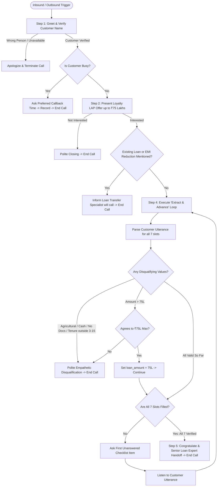

# Home Credit LAP AI Voice Agent: Architectural Design & Implementation Report

## 1. Executive Summary

This document outlines the end-to-end design, conversational architecture, and algorithmic decisions for the **Home Credit Pre-Approved Loan Against Property (LAP) AI Voice Agent**. 

The solution was engineered to satisfy all functional requirements and business edge cases specified by Home Credit:
- **Sequential 7-Point Qualification with Out-of-Order Memory**: Rigid questionnaires alienate banking customers. The agent implements opportunistic multi-slot entity extraction, updating internal qualification state and dynamically skipping redundant questions.
- **Immediate Disqualification Protocol**: If an applicant triggers a failure boundary (e.g., Agricultural property, Cash income, Unavailable original documents, Tenure <3 or >15 years), the agent politely terminates the call immediately, preserving brand goodwill and operational efficiency.
- **The "Transfer Logic Switch"**: Identifies customers with existing loans or EMI reduction requests and diverts them to loan transfer specialists without exposing them to standard fresh-loan qualification questionnaires.
- **Dynamic Variable Ingestion & Voice Constraints**: Full adherence to prompt variables (`{{company_name}}`, `{{customer_name}}`, `{{agent_name}}`, `{{agent_gender}}`, `{{current_date}}`, `{{current_day}}`, `{{current_time}}`, `{{additional_context_from_rag}}`, `{{language_to_speak}}`, `{{conversation_history}}`, `{{customer_utterance}}`), strictly enforcing grammatical gender agreement and voice-optimized turn brevity (<30 words per turn).

---

## 2. The 5-Layer Voice Architecture

```
                    ┌────────────────────────────────────────┐
                    │          LAYER 1: PERSONA & ACOUSTICS   │
                    │   • Tone: Financial Advisor (Empathetic)│
                    │   • Brevity: 1-2 sentences (<30 words) │
                    │   • Gender: Strict Grammatical Agreement│
                    └───────────────────┬────────────────────┘
                                        │
                    ┌───────────────────▼────────────────────┐
                    │     LAYER 2: DIALOGUE ORCHESTRATION    │
                    │   • Verification & Busy Gatekeeper     │
                    │   • Loyalty LAP Offer Presentation     │
                    │   • Diversion & Interruption Handling  │
                    └───────────────────┬────────────────────┘
                                        │
                    ┌───────────────────▼────────────────────┐
                    │      LAYER 3: COGNITIVE STATE ENGINE   │
                    │   • Extract Out-of-Order Multi-Slots   │
                    │   • Speech Repair & Overwrite Logic    │
                    │   • "First Missing Question" Algorithm │
                    └───────────────────┬────────────────────┘
                                        │
                    ┌───────────────────▼────────────────────┐
                    │      LAYER 4: BUSINESS DECISION RULES  │
                    │   • Immediate Disqualification Checks  │
                    │   • Transfer Switch (EMI/Existing)     │
                    │   • ₹75L Ceiling Alternative Offer     │
                    └───────────────────┬────────────────────┘
                                        │
                    ┌───────────────────▼────────────────────┐
                    │       LAYER 5: DISPOSITION & HANDOFF   │
                    │   • Strict Gate: All 7 Points Verified │
                    │   • Senior Human Loan Expert Handoff   │
                    │   • Polite Empathic Call Termination   │
                    └────────────────────────────────────────┘
```

---

## 3. State Machine & Decision Flow



---

## 4. Business Eligibility Matrix

| # | Data Point | Eligible Values | Disqualifying Values | Special Logic |
|---|---|---|---|---|
| **1** | **Property Type** | Residential (Flat, House), Commercial (Office, Shop), Industrial (Factory) | **Agricultural** (Farmland, Farm plots) | Immediate polite call termination. |
| **2** | **Ownership Status** | Sole ownership, Joint ownership | None specified | Both Sole and Joint are fully eligible. Do not disqualify co-owners. |
| **3** | **Original Documents** | Original deed/papers available at home/bank for physical verification | Photocopies only, missing, lost, disputed | Immediate polite call termination. |
| **4** | **Desired Loan Amount** | Up to ₹75,00,000 (₹75 Lakhs) | Customer refuses ₹75 Lakh maximum limit | **Ceiling Negotiation**: If customer asks > ₹75L, offer ₹75L cap. If accepted, proceed; if rejected, disqualify. |
| **5a** | **Occupation** | Salaried, Self-Employed | Unemployed/Retired (if no income) | Both Salaried and Self-Employed qualify. |
| **5b** | **Income Mode** | Bank Transfer / Account Credit / Cheque | **Cash Income** | Immediate polite call termination. |
| **6** | **Market Value** | Any estimated valuation provided by customer | None | **Zero-threshold rule**: No minimum property value cutoff exists. Never invent a minimum. |
| **7** | **Repayment Tenure** | 3 to 15 Years (inclusive) | **< 3 Years** or **> 15 Years** | Immediate polite call termination. |

---

## 5. The "Extract First, Validate Second, Update Third, Ask Fourth" Engine

One of the most frequent defects in conversational bots is "questionnaire blindness", where an agent asks a question that the user already answered in a previous sentence.

### Algorithmic Execution:
1. **Extraction (Slot-Filling)**:
   Suppose the user says:
   > *"Hi Priya, I have a residential apartment in Gurgaon worth around 1.2 Crore, jointly owned with my spouse. We need about 50 Lakhs."*
2. **State Transition**:
   ```json
   {
     "property_type": "RESIDENTIAL",
     "ownership_status": "JOINT",
     "market_value": "1.2 Crore",
     "loan_amount": "50 Lakhs",
     "documents_available": "UNKNOWN",
     "occupation": "UNKNOWN",
     "income_mode": "UNKNOWN",
     "tenure": "UNKNOWN"
   }
   ```
3. **Validation**: Check for Agricultural, Cash, Document issues. (All valid).
4. **First Missing Question Computation**:
   - Item 1 (Property Type): KNOWN (Residential)
   - Item 2 (Ownership): KNOWN (Joint)
   - **Item 3 (Documents): UNKNOWN** -> **TARGET SELECTED**
5. **Agent Utterance**:
   > *"Thank you for those details! Do you have the original property documents available for verification?"*

The agent completely skipped Item 1 and Item 2 without asking them again!

---

## 6. Voice Acoustic Engineering Best Practices

1. **Sub-30 Word Utterance Limit**:
   In telephone calls, human working memory degrades when listening to voice bots speak for more than 8-10 seconds continuously. Every prompt response is constrained to 1-2 spoken sentences.
2. **Rate Inquiries & Deferral Protocol**:
   When customers divert to ask *"What is your interest rate?"*:
   - Agents must never hallucinate rates (e.g. *"Our rate is 8.5%"*).
   - Agent acknowledges smoothly: *"Our interest rates are tailored based on the final property evaluation, which our senior loan expert will share with you right after this quick check. May I confirm [next item]?"*
3. **Gender Agreement in Hindi**:
   In Hindi, verbs conjugate by gender. The prompt enforces `{{agent_gender}}` strictly:
   - Female (`{{agent_gender}} = Female`): *"Main Priya bol rahi hoon... main samajh sakti hoon..."*
   - Male (`{{agent_gender}} = Male`): *"Main Rahul bol raha hoon... main samajh sakta hoon..."*

---

## 7. Retell AI / Bolna / Vapi Deployment Guide

### Retell AI Configuration:
1. **Model**: `gpt-4o-realtime-preview` or `claude-3-5-sonnet` (via Retell LLM).
2. **Prompt**: Paste [`system_prompt.txt`](file:///C:/Users/harsh/.gemini/antigravity-ide/scratch/salesagents-ai-lap-agent/system_prompt.txt).
3. **Voice**: `11labs-Adrian` or `11labs-Neerja` (Indian English/Hindi).
4. **Interruption Sensitivity**: `High` (0.8).
5. **End Call Tool**: Bind function `end_call()` when disqualification, transfer, or handoff occurs.

### Bolna Configuration:
1. **Agent Type**: Outbound Telephony Agent.
2. **LLM**: GPT-4o with temperature `0.1`.
3. **Synthesizer**: Deepgram Aura or ElevenLabs Multilingual v2.
4. **Input Variables**: Map `customer_name`, `company_name`, `agent_name`, `agent_gender`.
